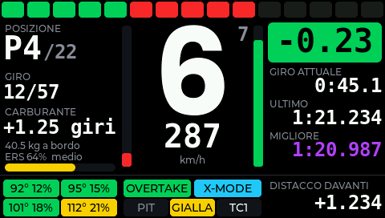
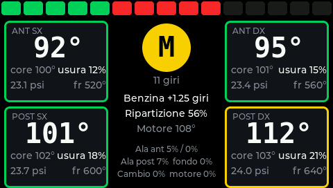
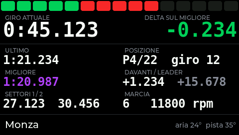

# SimDash: dashboard sim racing per ESP32-S3 4,3" (Guition JC4827W543)

Firmware ESP-IDF + LVGL 9 per la scheda ESP32-S3 N4R8 con display IPS 480×272 (controller NV3041A su QSPI, touch GT911). Riceve la telemetria via Wi-Fi in UDP, quindi funziona sia da PC sia da console.

| Gara | Gomme e auto | Tempi |
|---|---|---|
|  |  |  |

Le immagini sono rendering reali dell'interfaccia (LVGL eseguito su PC con dati di esempio).

## Giochi supportati

| Gioco | Piattaforme | Come si collega |
|---|---|---|
| EA F1 25, formato UDP **2026** (2026 Season Pack) e **2025** | PC, PS5, Xbox | UDP, porta configurabile (default 20777), anche Broadcast |
| Forza Motorsport (7, 2023), Forza Horizon 4/5 | PC, Xbox | "Data Out" UDP verso l'IP del dash |
| Gran Turismo 7 | PS4, PS5 | il dash invia l'heartbeat alla console, porte fisse 33739/33740 |
| DiRT Rally 2.0, DiRT 4, GRID (formato Codemasters "extradata 3") | PC, console | UDP |
| Assetto Corsa, Assetto Corsa Competizione | PC | `tools/simdash_bridge.py` |

Con la modalità **Automatico** il dash riconosce da solo F1, Forza, Codemasters e bridge PC sulla stessa porta. Per GT7 basta inserire l'IP della PlayStation nella pagina di configurazione.

Perché Wi-Fi e non Bluetooth: le console non possono inviare telemetria via Bluetooth, mentre F1, Forza e GT7 la trasmettono nativamente in UDP sulla rete di casa.

## Cosa mostra

**Schermata di avvio.** All'accensione compare il logo con una barra di caricamento e lo stato della connessione. Resta a schermo finché il Wi-Fi non è collegato (al massimo i 20 s del tentativo), poi lascia il posto alla schermata di stato; al primo avvio, o se la connessione non riesce, dopo un paio di secondi compare il QR della rete di configurazione. Per cambiare il logo: `python tools/make_logo.py mio_logo.png` rigenera `main/img_logo.c`.

**Pagina Gara.** Luci di cambiata a 15 LED (per F1 usa lo schema LED del gioco, per gli altri le soglie impostate), marcia, marcia suggerita, velocità, barre acceleratore/freno, posizione, giro, carburante (giri di margine in F1), ERS, **delta live sul giro migliore**, tempo attuale/ultimo/migliore, temperature e usura gomme, distacco. Indicatori: con regolamento 2026 **OVERTAKE** e **X-MODE / Z-MODE** (aero attiva), altrimenti DRS e ripartizione frenata; PIT, bandiere/SC/VSC/giro invalido, TC/ABS.

**Bandiere e safety car (F1).** Quando viene esposta una bandiera gialla, blu o rossa, oppure entra la safety car o la virtual safety car, compare per 3 secondi una fascia grande al centro dello schermo con il nome e cosa fare. Per tutta la durata la barra LED lampeggia nel colore della bandiera, al posto delle luci di cambiata, e lo schermo ha una cornice dello stesso colore. Vale su tutte le pagine. La bandiera rossa resta a schermo finché la gara non riparte (semafori spenti, nuovo giro, fine o nuova sessione). Forza, GT7 e gli altri giochi non inviano queste informazioni.

**Pagina Gomme.** Per ogni gomma: temperatura superficiale (bordo colorato), core, usura, pressione, temperatura freno. Al centro mescola ed età, carburante, ripartizione, motore, danni.

**Pagina Tempi.** Giro attuale e delta al millesimo, ultimo, migliore, settori, posizione, distacchi, circuito, temperature.

Si cambia pagina **toccando lo schermo** o premendo **BOOT**.

Il delta è calcolato dal dash stesso: durante ogni giro registra il tempo ogni 4 m di pista e lo confronta con il giro valido più veloce della sessione. Funziona anche con giochi che non forniscono il delta (per GT7 la distanza è stimata dalla velocità).

## Primo avvio

1. All'accensione il dash crea la rete **SimDash-XXXX**, password **simdash1**, e mostra un QR code.
2. Collegati col telefono (inquadra il QR). La pagina di configurazione si apre da sola, altrimenti vai su `http://192.168.4.1`.
3. Scegli la rete di casa, il gioco, la porta e premi **Salva e riavvia**.
4. Dopo il riavvio lo schermo mostra l'**IP del dash**: è quello da inserire nel gioco. Le impostazioni restano modificabili da `http://<IP del dash>`.

Se il dash non si collega entro 20 s riapre la rete di configurazione. Per tornarci in qualsiasi momento tieni premuto **BOOT per 3 secondi**.

Consiglio: nel router assegna un IP fisso (prenotazione DHCP) al dash, così non devi cambiarlo nel gioco.

## Impostazioni nei giochi

**F1 25.** Impostazioni › Telemetria UDP: Telemetria UDP *On*, Modalità broadcast *On* (oppure IP del dash), Porta *20777*, Frequenza di invio *60 Hz*, Formato UDP *2026* se usi il 2026 Season Pack (va bene anche *2025*). "La tua telemetria" può restare Limitata: i dati della tua auto sono sempre disponibili.

**Forza.** Impostazioni › HUD e gameplay: Data Out *On*, Data Out IP Address = IP del dash, Data Out IP Port = porta del dash (es. 20777). In Forza Motorsport 2023 scegli il formato "Car Dash".

**Gran Turismo 7.** Nessuna impostazione nel gioco. Nella pagina del dash scrivi l'IP della PS4/PS5 (Impostazioni › Rete › Visualizza stato connessione) e scegli "Gran Turismo 7" oppure "Automatico".

**DiRT Rally 2.0 / GRID.** Nel file `Documents/My Games/<gioco>/hardwaresettings/hardware_settings_config.xml` imposta `<udp enabled="true" extradata="3" ip="<IP del dash>" port="20777" delay="1" />`.

**Assetto Corsa / ACC.** Sul PC con Python 3:
```
python tools/simdash_bridge.py --ip <IP del dash> --sim acc     (oppure --sim ac)
```
Per provare il dash senza gioco: `python tools/simdash_bridge.py --ip <IP del dash> --sim demo`.

## Installazione rapida (firmware già compilato)

In `firmware/simdash-1.1.1_completo_0x0.bin` c'è l'immagine completa (bootloader, tabella partizioni, dati OTA e app) da scrivere all'indirizzo 0x0:
```
pip install esptool
esptool.py --chip esp32s3 -p COM5 -b 921600 erase_flash
esptool.py --chip esp32s3 -p COM5 -b 921600 write_flash --flash_mode keep --flash_freq keep --flash_size keep 0x0 firmware/simdash-1.1.1_completo_0x0.bin
```
In alternativa usa un flasher web (es. ESP Web Flasher) con lo stesso file all'offset 0x0. Se la scheda non entra in programmazione tieni premuto BOOT, premi e rilascia RST, poi rilascia BOOT.

**Importante: non forzare la modalità QIO.** Su ESP32-S3 il bootloader deve avere nell'intestazione la modalità DIO: è il bootloader stesso che poi attiva la QIO. Se un flasher ha l'opzione "Flash mode", scegli *keep* oppure *DIO*. Con QIO forzato la scheda si riavvia in continuo con `ets_loader.c 78` nel monitor seriale. Non si rovina nulla: basta riscrivere il file nel modo corretto.

`erase_flash` cancella anche le impostazioni salvate: dopo la prima installazione dovrai rifare la configurazione dal telefono. Puoi ometterlo se arrivi da un'installazione SimDash funzionante.

**Se arrivi dalla 1.0** questo passaggio va fatto una volta via USB, perché cambiano tabella delle partizioni e bootloader. Le impostazioni (Wi-Fi, gioco, luci) vengono conservate. Dalla 1.1 in poi gli aggiornamenti si fanno senza cavo.

## Aggiornamenti firmware (OTA)

La flash da 4 MB è divisa in due partizioni app da 1,9 MB: il nuovo firmware viene scritto in quella libera mentre il dash continua a funzionare, poi si riavvia su quella nuova. Se il nuovo firmware non riesce a partire correttamente per 20 secondi (crash, riavvii continui), il bootloader torna da solo alla versione precedente.

Prima di scrivere, il dash controlla che il file sia un firmware per ESP32-S3 del progetto "simdash"; alla fine verifica l'integrità dell'immagine e, se il manifest lo indica, lo SHA-256 del file.

### 1. Caricare un .bin dal browser

Apri `http://<IP del dash>` (oppure `http://192.168.4.1` in modalità configurazione), sezione **Firmware**, scegli il file (`build/simdash.bin` oppure `release/simdash-X.Y.Z.bin`) e premi **Carica firmware**. Sul dash compare la barra di avanzamento, poi si riavvia.

Va caricato il file dell'app, non l'immagine "completo_0x0": quella serve solo per la prima installazione via USB.

### 2. Controllo automatico di nuove versioni

Nella sezione **Firmware** imposta l'URL di un **manifest JSON** e lascia attivo "Controlla da solo". Il dash lo legge 15 secondi dopo la connessione e poi ogni 6 ore. Se trova una versione più nuova:

- sullo schermo compare la richiesta **Installa / Dopo**, ma solo quando non stai guidando (nessuna telemetria da 3 s, gioco in menu o auto ferma). Senza touch: premi BOOT = dopo, tieni premuto 2 s = installa. "Dopo" rimanda la richiesta di 24 ore;
- nella pagina web compare il pulsante **Installa X.Y.Z**;
- puoi anche forzare un controllo con **Cerca aggiornamenti**.

### Endpoint: il manifest

È un file JSON statico, ospitabile ovunque (HTTPS con certificato pubblico oppure HTTP in rete locale):

```json
{
  "project": "simdash",
  "version": "1.2.0",
  "url": "simdash-1.2.0.bin",
  "size": 1478544,
  "sha256": "56ba41e8ca588ad5529014b4e9e39386625d1fcf13302b5cbaf49ef649050423",
  "notes": "Testo breve mostrato sul dash"
}
```

| Campo | Obbligatorio | Significato |
|---|---|---|
| `version` | sì | confrontata con la versione installata (formato `X.Y.Z`, la "v" iniziale è ammessa) |
| `url` | sì | indirizzo del .bin, assoluto oppure relativo al manifest |
| `project` | no | se presente deve essere `simdash` |
| `sha256` | no | se presente il file scaricato deve corrispondere, altrimenti non viene installato |
| `size` | no | informativo |
| `notes` | no | max ~150 caratteri, solo ASCII (il font del display non ha le lettere accentate) |

Lo script `tools/make_manifest.py` prepara tutto da solo: legge versione e progetto dal binario, calcola SHA-256 e dimensione, toglie gli accenti dalle note e crea la cartella `release/` con `manifest.json` e il .bin.

```
# 1. alza la versione in CMakeLists.txt:  set(PROJECT_VER "1.2.0")
idf.py build
python tools/make_manifest.py --notes "Cosa cambia"
```

**Dove pubblicarlo**

- **GitHub Releases** (consigliato): crea una release e allega `manifest.json` e `simdash-X.Y.Z.bin`. Nel dash usa come URL `https://github.com/<utente>/<repo>/releases/latest/download/manifest.json`: punta sempre all'ultima release, e il .bin con url relativo viene trovato accanto. I redirect di GitHub sono gestiti.
- **Qualsiasi hosting statico** HTTPS (sito, bucket S3/R2, Netlify...): i certificati pubblici più comuni sono già inclusi nel firmware.
- **PC in rete locale**, per sviluppo: `cd release` poi `python -m http.server 8000`, e nel dash l'URL `http://<IP del PC>:8000/manifest.json`.

### API REST del dash

Le stesse funzioni sono disponibili per script e automazioni:

| Metodo e percorso | Cosa fa |
|---|---|
| `GET /api/update/status` | `{"state":3,"prog":0,"cur":"1.1.0","new":"1.2.0","notes":"...","msg":"..."}`. Stati: 0 nessuno, 1 controllo in corso, 2 aggiornato, 3 disponibile, 4 download, 5 upload, 6 completato (riavvio), 7 errore |
| `POST /api/update/check` | legge subito il manifest |
| `POST /api/update/install` | scarica e installa la versione disponibile |
| `POST /api/ota` | corpo = file .bin; risponde `{"ok":true,"version":"1.2.0"}` oppure `{"error":"..."}` |

Esempio di aggiornamento dal terminale dopo un build:
```
curl --data-binary @build/simdash.bin http://192.168.1.137/api/ota
```

Nota di sicurezza: chiunque sia sulla stessa rete Wi-Fi può caricare un firmware. Il dash accetta solo immagini del progetto "simdash" per ESP32-S3, ma non c'è una password: non collegarlo a reti di cui non ti fidi.

## Compilare dai sorgenti

Serve ESP-IDF **5.3 o superiore** (testato con 5.4.2 e 6.0.1). Le dipendenze (LVGL 9.3, esp_lvgl_port, driver GT911) vengono scaricate automaticamente dal component manager al primo build.
```
idf.py set-target esp32s3
idf.py build
idf.py -p COM5 flash monitor
```
Opzioni hardware in `idf.py menuconfig` › *SimDash board*: clock QSPI (32 MHz di default, 40 spesso funziona), altezza buffer di disegno, presenza touch GT911, mirroring del touch, valore MADCTL base del pannello.

## Architettura

```
core 0: Wi-Fi + lwIP ─► udp_rx (select su 20777 e 33740) ─► parser ─► telemetry (copia atomica)
core 1: LVGL (esp_lvgl_port) ─► ui_tick ogni 15 ms ─► aggiorna solo i widget cambiati ─► QSPI DMA
```

| File | Contenuto |
|---|---|
| `main/lcd_nv3041a.c` | driver esp_lcd per NV3041A su QSPI (sequenza di init del produttore) |
| `main/display.c` | bus QSPI, retroilluminazione PWM, LVGL, touch GT911 |
| `main/wifi_mgr.c` | stazione / access point, DNS captive portal, Wi-Fi senza risparmio energetico |
| `main/web_portal.c` | pagina di configurazione e API (impostazioni, scansione reti, aggiornamenti) |
| `main/ota_mgr.c` | aggiornamenti: upload, manifest online, download, verifica, rollback |
| `main/udp_rx.c` | ricezione UDP, riconoscimento automatico del gioco, heartbeat GT7 |
| `main/proto_f1.c` | F1 25, formati 2025 (22 auto) e 2026 (24 auto, pacchetto 16 Car Telemetry 2) |
| `main/proto_forza.c` | Forza Motorsport / Horizon "Data Out" |
| `main/proto_gt7.c` | GT7 con decifratura Salsa20 |
| `main/proto_misc.c` | Codemasters legacy e protocollo generico "SDSH" (documentato nel file) |
| `main/telemetry.c` | modello dati condiviso e calcolo del delta live |
| `main/ui.c` | le tre pagine, LED, schermate di attesa e configurazione |
| `tools/simdash_bridge.py` | bridge per AC/ACC e generatore di dati demo |
| `tools/make_manifest.py` | prepara manifest.json e .bin per una nuova release |

Memoria: la RAM interna (circa 340 KB) è riservata a Wi-Fi, lwIP e ai due buffer di disegno DMA (24 righe); tutti gli oggetti LVGL sono allocati nella PSRAM da 8 MB (`main/lv_mem_psram.c`). All'avvio il monitor seriale stampa la RAM interna libera prima del Wi-Fi e a fine avvio.

Scelte per la fluidità: doppio buffer DMA in RAM interna (40 righe), invio pixel in DMA mentre LVGL disegna il blocco successivo, ridisegno solo delle aree cambiate, font monospaziati per i numeri (niente "salti" del testo), UI e rete su core separati, ricezione che svuota la coda e tiene solo lo stato più recente, Wi-Fi power save disattivato.

Il protocollo generico è utile per collegare qualsiasi altro simulatore: basta inviare il pacchetto da 120 byte descritto in `main/proto_misc.c` (vedi `pack()` nello script Python).

## Cosa è stato verificato e cosa no

Verificato: il firmware 1.1.1 compila senza errori né warning con ESP-IDF 5.4.2 e LVGL 9.3; parsing del manifest, confronto versioni, risoluzione degli URL relativi e JavaScript della pagina web sono stati provati su PC; il controllo dell'intestazione (chip, progetto, versione) è stato verificato sul binario reale; i parser F1 (2025 e 2026), Forza, GT7, Codemasters e generico sono stati provati su PC con pacchetti costruiti secondo le specifiche; la cifratura Salsa20 di GT7 coincide con un'implementazione di riferimento; l'interfaccia è stata renderizzata con LVGL per controllare l'impaginazione.

Da verificare sulla scheda vera:
- **Orientamento del display.** Se l'immagine è capovolta usa "Ruota lo schermo di 180°"; se è specchiata cambia *Base MADCTL* in menuconfig (prova 0x00, 0x40, 0x80).
- **Touch.** Il tocco serve solo a cambiare pagina, quindi funziona anche se gli assi sono invertiti. Sulla versione resistiva o senza touch usa il tasto BOOT.
- **Offset di GT7.** Vengono dalla documentazione della community, non da specifiche ufficiali; in particolare la mappatura della retromarcia.
- **Ciclo OTA completo.** Upload, download e rollback usano le API standard di ESP-IDF ma vanno provati sulla scheda: la prima volta tieni a portata il cavo USB.
- **ERS nel 2026.** La percentuale è calcolata su 4 MJ, come nel regolamento precedente: con le regole 2026 è un'indicazione relativa.

## Licenze

Codice SimDash: MIT. Font generati con lv_font_conv da Poppins (SIL OFL) e DejaVu Sans Mono (licenza Bitstream Vera/DejaVu). Sequenza di init NV3041A da Arduino_GFX (BSD). LVGL: MIT.
