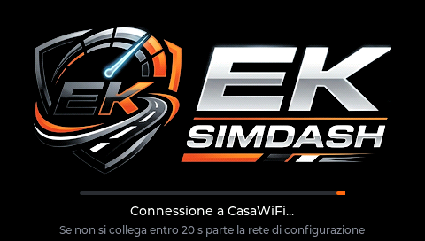
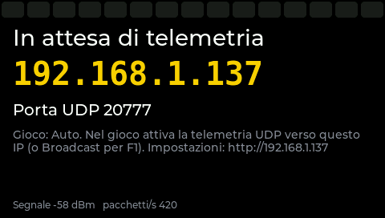
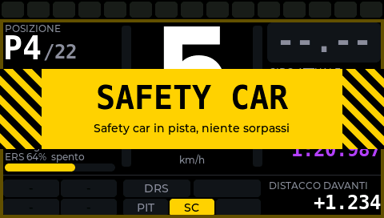
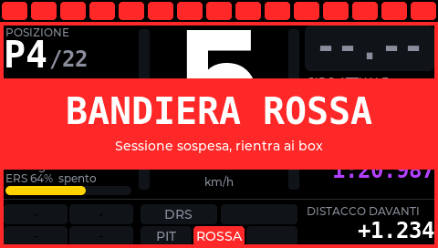
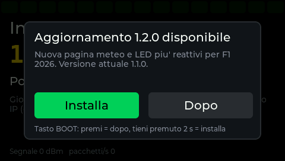

# EK SimDash – Guida utente

EK SimDash è un piccolo display da 4,3" da mettere accanto al volante. Mostra in tempo reale marcia, luci di cambiata, tempi, gomme, bandiere e molto altro.

I dati arrivano dal gioco **via Wi-Fi**, quindi funziona sia con il PC sia con PlayStation e Xbox, senza cavi verso la console.


---

## Indice

1. [Giochi supportati](#giochi-supportati)
2. [Installare il firmware (prima volta)](#installare-il-firmware-prima-volta)
3. [Prima configurazione](#prima-configurazione)
4. [Impostazioni nei giochi](#impostazioni-nei-giochi)
5. [Cosa mostra il display](#cosa-mostra-il-display)
6. [Aggiornamenti](#aggiornamenti)
7. [Problemi comuni](#problemi-comuni)

---

## Giochi supportati

| Gioco | Piattaforme |
|---|---|
| EA F1 25 (anche con il 2026 Season Pack) | PC, PS5, Xbox |
| Forza Motorsport (7 e 2023), Forza Horizon 4 e 5 | PC, Xbox |
| Gran Turismo 7 | PS4, PS5 |
| DiRT Rally 2.0, DiRT 4, GRID | PC, console |
| Assetto Corsa, Assetto Corsa Competizione | PC (serve un piccolo programma sul PC) |

Bandiere e safety car sono disponibili **solo con F1**: gli altri giochi non inviano queste informazioni.

---

## Installare il firmware (prima volta)

Questo passaggio va fatto **una sola volta**, con il cavo USB. Da lì in poi gli aggiornamenti arrivano da soli via Wi-Fi.

### Cosa serve

- La scheda **Guition JC4827W543** (ESP32-S3, display 4,3").
- Un cavo **USB-C dati**. Alcuni cavi caricano soltanto e non trasmettono dati: se il PC non vede la scheda, prova un altro cavo.
- Un PC con **Chrome** o **Edge**.
- Il file **`simdash-X.Y.Z_completo_0x0.bin`**, che trovi negli allegati dell'ultima release: [github.com/maurizioterreni/SimDash/releases](https://github.com/maurizioterreni/SimDash/releases).

### Metodo facile: dal browser

1. Collega la scheda al PC con il cavo USB.
2. Apri **[espressif.github.io/esptool-js](https://espressif.github.io/esptool-js/)** con Chrome o Edge.
3. Premi **Connect** e scegli la porta della scheda. Su Windows di solito compare come "USB JTAG/serial debug unit" o come una porta COM.
4. Premi **Erase Flash** e attendi che finisca.
5. Nel campo **Flash Address** scrivi `0x0` e scegli il file `simdash-X.Y.Z_completo_0x0.bin`.
6. Premi **Program** e attendi la fine.
7. Scollega e ricollega il cavo: sullo schermo deve comparire il logo EK SimDash.

### Metodo da terminale (alternativa)

Con Python installato:

```
pip install esptool
esptool.py --chip esp32s3 -p COM5 -b 921600 erase_flash
esptool.py --chip esp32s3 -p COM5 -b 921600 write_flash --flash_mode keep --flash_freq keep --flash_size keep 0x0 simdash-X.Y.Z_completo_0x0.bin
```

Al posto di `COM5` usa la porta della tua scheda. Su Mac e Linux è qualcosa come `/dev/ttyACM0`.

### Se qualcosa non va

- **La scheda non si collega o non entra in programmazione:** tieni premuto il tasto **BOOT**, premi e rilascia **RST**, poi rilascia BOOT. Quindi riprova.
- **Lo schermo resta nero e la scheda si riavvia in continuo:** probabilmente il flash è stato scritto in modalità **QIO**. Se il programma ha un'opzione "Flash mode", scegli **keep** oppure **DIO**, poi riscrivi il file. Non si rovina nulla.
- **"Erase Flash" cancella anche le impostazioni salvate.** Dopo l'installazione dovrai rifare la configurazione dal telefono.

---

## Prima configurazione



1. **Accendi il dash.** Compare il logo con una barra di caricamento. Al primo avvio, dopo un paio di secondi, lascia il posto a un **QR code**.
2. **Collegati col telefono:** inquadra il QR, oppure collegati a mano alla rete **SimDash-XXXX** con password **`simdash1`**.
3. **Apri la pagina di configurazione.** Di solito si apre da sola; altrimenti apri il browser e vai su **`http://192.168.4.1`**.
4. **Compila i campi principali:**
   - la **rete Wi-Fi di casa** e la sua password;
   - il **gioco** (con "Automatico" il dash riconosce da solo F1, Forza e gli altri);
   - la **porta**: lascia **20777** se non hai motivo di cambiarla.
5. **Premi "Salva e riavvia".**
6. Al riavvio il dash si collega alla tua rete e mostra il suo **indirizzo IP**, per esempio `192.168.1.137`. **Annotalo**: è quello da inserire nel gioco.



Le impostazioni si possono cambiare in qualsiasi momento: apri `http://<IP del dash>` dal telefono o dal PC.

Se il dash non riesce a collegarsi entro 20 secondi, per esempio perché hai cambiato password del Wi-Fi, riapre da solo la rete **SimDash-XXXX** con il QR code. Basta ripetere la configurazione.

**Consiglio:** nelle impostazioni del router assegna un **IP fisso** al dash (si chiama "prenotazione DHCP" o "IP statico"). Così l'indirizzo non cambia e non devi reinserirlo nel gioco.

---

## Impostazioni nei giochi

### F1 25

*Impostazioni › Telemetria*:

| Voce | Valore |
|---|---|
| Telemetria UDP | On |
| Modalità broadcast | On (oppure scrivi l'IP del dash) |
| Porta UDP | 20777 |
| Frequenza di invio | 60 Hz |
| Formato UDP | 2026 se hai il 2026 Season Pack, altrimenti 2025 |

"La tua telemetria" può restare su *Limitata*.

### Forza Motorsport / Forza Horizon

*Impostazioni › HUD e gameplay*:

| Voce | Valore |
|---|---|
| Data Out | On |
| Data Out IP Address | IP del dash |
| Data Out IP Port | 20777 |

In Forza Motorsport 2023 scegli il formato **"Car Dash"**.

### Gran Turismo 7

Nel gioco non c'è nulla da impostare.

1. Trova l'IP della PlayStation in *Impostazioni › Rete › Visualizza stato connessione*.
2. Nella pagina del dash scrivilo nel campo dell'IP della console.
3. Scegli **Gran Turismo 7** oppure **Automatico**.

### DiRT Rally 2.0 / DiRT 4 / GRID

Apri il file `Documenti/My Games/<gioco>/hardwaresettings/hardware_settings_config.xml` e modifica la riga `udp` così:

```xml
<udp enabled="true" extradata="3" ip="IP-DEL-DASH" port="20777" delay="1" />
```

### Assetto Corsa / ACC

Serve il programma `simdash_bridge.py`, che trovi nella cartella `tools` del progetto, e Python 3 sul PC. Avvialo mentre giochi:

```
python simdash_bridge.py --ip IP-DEL-DASH --sim acc
```

Per Assetto Corsa usa `--sim ac`. Con `--sim demo` puoi provare il dash anche senza gioco.

---

## Cosa mostra il display

**Tocca lo schermo** per passare da una pagina all'altra. Nella pagina web puoi scegliere quale pagina mostrare all'accensione.

### Barra delle luci (in alto, su tutte le pagine)

Sono 15 luci di cambiata: verdi, poi rosse, poi blu. Quando lampeggiano tutte è il momento di cambiare marcia.

Con F1 la barra segue lo schema del gioco. Con gli altri giochi usa le soglie che imposti nella pagina web.

### Pagina Gara


| Zona | Cosa trovi |
|---|---|
| Sinistra | Posizione, giro, carburante (in F1 i giri di margine), ERS |
| Centro | Marcia grande, marcia suggerita, velocità, barre di acceleratore e freno |
| Destra | **Delta live** rispetto al tuo giro migliore (verde se sei più veloce, rosso se più lento), giro attuale, ultimo, migliore |
| In basso | Temperatura e usura delle 4 gomme, indicatori (OVERTAKE / X-MODE o DRS, PIT, bandiera, TC/ABS), distacco dall'auto davanti |

Il delta lo calcola il dash: dopo il primo giro valido della sessione ha un riferimento e da lì in poi ti dice in tempo reale se stai guadagnando o perdendo.

### Pagina Gomme e auto


Per ogni gomma vedi:
- la temperatura grande; il colore del bordo indica se è fredda, giusta o surriscaldata;
- la temperatura interna;
- l'usura;
- la pressione;
- la temperatura del freno.

Al centro ci sono mescola ed età delle gomme, carburante, ripartizione della frenata, temperatura del motore e danni.

### Pagina Tempi


Mostra il giro attuale e il delta al millesimo, l'ultimo giro, il giro migliore, i settori, la posizione, i distacchi, il circuito e le temperature di aria e pista.

### Bandiere e safety car (solo F1)



Quando viene esposta una bandiera o entra la safety car:
- al centro compare per 3 secondi una **fascia grande** con il nome e cosa fare;
- per tutta la durata **la barra delle luci lampeggia** nel colore della bandiera, al posto delle luci di cambiata;
- lo schermo ha una **cornice** dello stesso colore.

| Situazione | Colore |
|---|---|
| Safety car, virtual safety car, bandiera gialla | Giallo, con strisce di pericolo |
| Bandiera blu | Blu |
| Bandiera rossa | Rosso |



La **bandiera rossa** resta a schermo finché la gara non riparte.

---

## Aggiornamenti

Il dash si aggiorna **da solo via internet**: non serve più il cavo.

- Controlla se c'è una nuova versione **15 secondi dopo essersi collegato** al Wi-Fi e poi **ogni 6 ore**.
- Se ne trova una, sullo schermo compare la richiesta **Installa / Dopo**, ma solo quando non stai guidando. "Dopo" la ripropone il giorno seguente.
- Durante l'aggiornamento vedi una barra di avanzamento; alla fine il dash si riavvia da solo. Le impostazioni restano.
- Se qualcosa va storto, il dash torna automaticamente alla versione precedente.



Dalla pagina web (`http://<IP del dash>`, sezione **Firmware**) puoi anche:
- vedere la versione installata;
- premere **Cerca aggiornamenti** per controllare subito;
- disattivare il controllo automatico.

---

## Problemi comuni

**Il dash resta su "In attesa di telemetria".**
Controlla nell'ordine:
- che nel gioco sia attiva la telemetria;
- che l'IP e la porta nel gioco siano quelli mostrati dal dash;
- che console o PC siano sulla **stessa rete Wi-Fi** del dash.

Con F1 prova ad attivare la modalità broadcast. Con GT7 ricontrolla l'IP della PlayStation nella pagina del dash.

**Ho cambiato rete Wi-Fi o password.**
Accendi il dash e attendi 20 secondi: non riuscendo a collegarsi, riapre la rete **SimDash-XXXX** con il QR code. Rifai la [prima configurazione](#prima-configurazione).

**L'immagine è capovolta.**
Nella pagina web attiva **"Ruota lo schermo di 180°"**.

**L'IP del dash cambia ogni tanto.**
Assegnagli un IP fisso dal router (vedi il consiglio nella [prima configurazione](#prima-configurazione)).

**Sicurezza.**
Chiunque sia sulla stessa rete Wi-Fi può aprire la pagina del dash. Collegalo solo alla rete di casa o comunque a reti di cui ti fidi.
